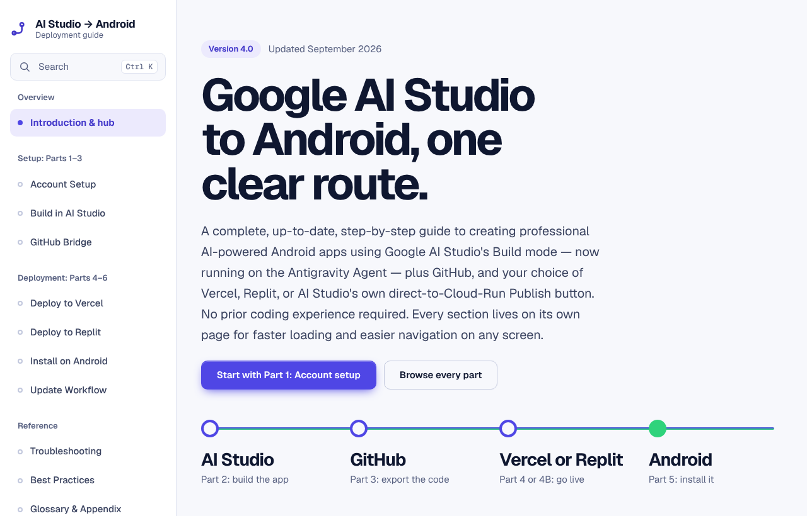
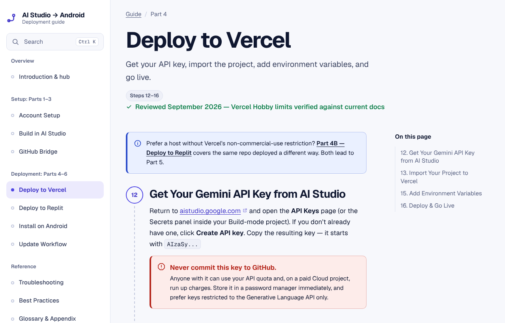
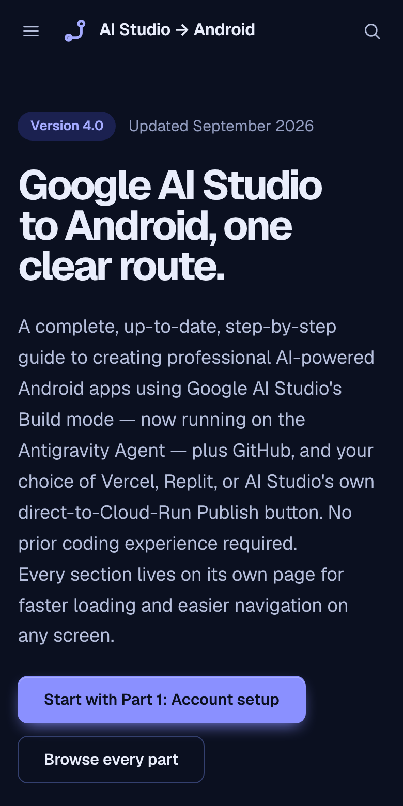

<div align="center">

<picture>
  <source media="(prefers-color-scheme: dark)" srcset="docs/assets/logo-dark.svg">
  
</picture>

**A step-by-step guide to turning a Google AI Studio project into an Android app you can install from your home screen.**

[](https://github.com/babatundeawo/ai-studio-android-guide/actions/workflows/deploy.yml)
[](https://babatundeawo.github.io/ai-studio-android-guide/)


[Live site](https://babatundeawo.github.io/ai-studio-android-guide/) ·
[Documentation](docs/) ·
[Report an issue](https://github.com/babatundeawo/ai-studio-android-guide/issues/new/choose)

</div>

<p align="center">
  
</p>

## About

AI Studio → Android is a free, multi-page guide for anyone who wants to ship an AI-powered app without prior coding experience. It starts with account setup, builds an app in Google AI Studio's Build mode, moves the code to GitHub, publishes it with Vercel, Replit, or AI Studio's own Publish button, and finishes by installing the live app on an Android phone as a Progressive Web App (PWA). Allow 45–60 minutes.

## Features

- Ten focused pages, each with its own address, covering setup, building, deploying, installing, updating, troubleshooting, best practices, and a glossary.
- Numbered steps along a route line, with the critical steps marked.
- One-click copy buttons on every code sample and file template.
- Search across steps, errors, and glossary terms with Ctrl K (⌘ K on Mac), or `/`.
- A troubleshooting page with a quick diagnosis and eight expandable fixes.
- A comparison of three hosting routes and a free-tier limits table.
- Light and dark themes that follow your system and remember your choice.
- Reads well on phones, and works offline after your first visit.
- Print-friendly pages.

## How to use it

1. Open the [live site](https://babatundeawo.github.io/ai-studio-android-guide/) and choose **Start with Part 1**, or pick a part from the sidebar.
2. Follow the numbered steps in order. Parts 1 to 3 are shared; in Part 4 choose Vercel (Part 4) or Replit (Part 4B), or use AI Studio's Publish button described in Part 2.
3. Press **Ctrl K** (⌘ K on Mac) to jump to any step, error message, or term.
4. If something breaks, open **Troubleshooting** and follow the quick diagnosis.

<p align="center">
  
  
</p>

## Tech stack

- Hand-written HTML, CSS, and JavaScript with no frameworks
- A small build script (Node.js) that assembles pages from shared templates
- [Geist and Geist Mono](https://vercel.com/font), self-hosted
- GitHub Actions and GitHub Pages for building and hosting

## Project structure

```
.
├── src/
│   ├── pages/       One file per page of the guide (content)
│   ├── partials/    Shared page layout and icon set
│   ├── css/         Design tokens and styles
│   └── js/          Navigation, search, theme, copy buttons, offline support
├── public/          Fonts, icons, and the social preview image
├── scripts/         Build and quality-check scripts
├── docs/            Maintainer guides and README images
├── site.json        Site name, version, navigation, and page order
└── .github/         Deployment, security scan, and issue templates
```

## Contributing

Spotted a mistake or an out-of-date step? [Open an issue](https://github.com/babatundeawo/ai-studio-android-guide/issues/new/choose) or send a pull request. [CONTRIBUTING.md](CONTRIBUTING.md) explains how, using only the GitHub website.

## Security

To report a vulnerability privately, see [SECURITY.md](SECURITY.md).

## License and credits

© 2025–2026 Techbase Consultant Services. Published for educational reference. You may share and adapt it with attribution.

Fonts: [Geist](https://github.com/vercel/geist-font) and Geist Mono by Vercel and Basement Studio, used under the [SIL Open Font License 1.1](public/fonts/OFL-Geist.txt).

## Author

**Babatunde Awoyemi**, Atmospheric Physicist & Lead Consultant, [Techbase Consultant Services](https://techbasengr.com.ng), Ibadan, Nigeria.
[github.com/babatundeawo](https://github.com/babatundeawo) · [x.com/ba_awoyemi](https://x.com/ba_awoyemi)

For maintainers: [Deployment guide](docs/DEPLOYMENT.md) · [Customizing guide](docs/CUSTOMIZING.md)
